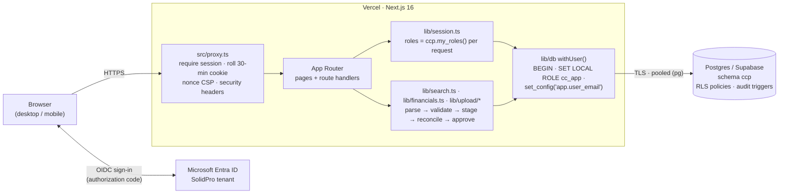

# SolidPro Cost Centre Portal

Internal web portal for **Solidpro Engineering Support Pvt Ltd**. It is the single source of truth
for cost centres. Employees use it to find the right cost centre code in seconds. Finance uses it
to maintain the cost centre master and its owners under audit, and to publish budget and actuals
that reconcile to the trial balance. Cost centre owners, BU heads and Management see budget against
actuals for the cost centres they are responsible for.

Next.js 16 (App Router) · TypeScript · Tailwind CSS v4 · Auth.js v5 with Microsoft Entra ID ·
Postgres with row-level security (Supabase in production, embedded PGlite for local demos) ·
Recharts · deployed on Vercel at `https://costcentre.solidpro-engineering.com`.

**Status: Phase 2.** Phase 1 delivered Microsoft sign-in, the Cost Centre Finder, and Admin
uploads of the cost centre master and owner mapping. Phase 2 adds **My Cost Centres** (budget
against actuals, variances, Excel export), the **Budget & Actuals upload** with trial-balance
reconciliation, and **maker-checker** approval of every upload.

---

## Contents

1. [Business problem](#1-business-problem)
2. [Roles](#2-roles)
3. [Architecture](#3-architecture)
4. [Security model](#4-security-model)
5. [Quick start (local demo)](#5-quick-start-local-demo)
6. [Environment variables](#6-environment-variables)
7. [Microsoft Entra ID SSO](#7-microsoft-entra-id-sso)
8. [Supabase setup](#8-supabase-setup)
9. [Deploy to Vercel](#9-deploy-to-vercel)
10. [Granting roles](#10-granting-roles)
11. [Testing](#11-testing)
12. [Acceptance criteria](#12-acceptance-criteria)
13. [Roadmap](#13-roadmap)
14. [Known limitations and next steps](#14-known-limitations-and-next-steps)

Finance users should read the [Finance Admin Guide](docs/ADMIN_GUIDE.md), which covers the monthly SOP
(including the Budget & Actuals close), upload rules, trial-balance reconciliation, maker-checker and
every error code.

---

## 1. Business problem

Cost centre codes currently live in spreadsheets that Finance maintains. Employees who raise expense
claims, purchase requests and invoices guess the code or email Finance to ask. Mis-coded costs then
need reclassification journals at month-end. Owners are not recorded consistently, and no one can
easily see who changed a code and when.

The portal fixes this:

- **Finder.** Any employee can search by name, code, BU, department, owner or keyword, in any order and
  with partial words, and copy the code with one click. If nothing matches, the portal shows the
  Finance contact and logs the search so that Finance can add keywords.
- **Controlled master data.** Finance changes the master only through validated Excel/CSV uploads.
  An upload is all-or-nothing, is checked again when it is published, and every change is audited.
  Cost centres are never deleted; they are deactivated instead.
- **Ownership.** Every active cost centre has an owner and a backup owner. The owner mapping also
  controls who can see a cost centre's budget and actuals.
- **Budget against actuals.** *My Cost Centres* shows owners, BU heads and Management the month,
  year-to-date and full-year figures for their cost centres, broken down by GL group and month, with
  variances over ±10% flagged and an Excel export.
- **Reconciled, approved financials.** Finance loads budget and actuals from Tally through the same
  validated uploads. A month's actuals cannot be published unless the cost centre totals equal the
  trial balance, and a second Finance user must approve every upload.

**How the figures are calculated** (`src/lib/fiscal.ts`, `src/lib/financials.ts`):

- The fiscal year starts in April (`FY_START_MONTH=4`): FY 2026-27 is April 2026 to March 2027.
- **Variance = Actual − Budget**, so a **positive variance is an overspend**. Variance % is variance ÷ |budget|.
- A line is **flagged** when the variance is more than ±10% of budget, or when there is an actual against a zero budget.
  Cost centres, BUs and GL groups are flagged on their year-to-date figures; the month card and the monthly trend
  on that month's figures.
- **YTD** runs from the first month of the fiscal year to the *As of* month. The *As of* selector lists the months
  that have published actuals, latest first.
- **Full-year outturn = YTD actual + budget for the remaining months of the fiscal year.**
- Amounts are shown without a currency symbol, in Indian digit grouping, and are not converted between entities.

## 2. Roles

Roles are **read from the database on every request**. The session cookie only says who the user is.
Removing a grant or changing an owner therefore takes effect immediately.

| Role | How a user gets it | Phase 1 (live) | Phase 2 (live) | Phase 3 |
|---|---|---|---|---|
| **Employee** | Any account on an allowed domain that can sign in | Finder: search active cost centres; see code, alias, BU, department, owner name and entity; copy the code; "Contact Finance" when nothing matches. **No financial data.** | No change: no *My Cost Centres* menu and **no financial data** | — |
| **CC Owner / Backup** | Named as `Owner_Email` or `Backup_Owner_Email` in the owner mapping upload | Finder | **My Cost Centres** for their own cost centres only: month, YTD and full-year budget, actual and variance, outturn, GL-group breakdown and monthly trend, ±10% flags, **Export to Excel** | Comment on variances; see allocations into their cost centre |
| **BU Head** | A `BU_Head` grant for a BU in `ccp.cc_access` (sees the whole BU), or named as `BU_Head_Email` in the owner mapping (sees those cost centres) | Finder | **My Cost Centres** for every cost centre in their BU (or those naming them), with a by-BU summary | Comments and allocations for their BU |
| **Finance Admin** | A `Finance` grant in `ccp.cc_access` | Finder and **Admin**: template download; upload, validate, publish and discard of the master and owner mapping; data-quality exceptions; recent uploads; audit log; failed-searches report. **The only role that can write master data.** | **Budget & Actuals upload** with trial-balance reconciliation; **maker-checker** on every upload (the preparer uploads and enters the trial balance, a *different* Finance user approves and publishes); *Awaiting approval* queue; *Published periods* register; My Cost Centres for every cost centre | Allocations upload; audit reports and exports |
| **Management / CFO** | An `Mgmt` grant in `ccp.cc_access` | Finder (read access to all cost centres is already enforced in the database) | **My Cost Centres**: company-wide, read-only, consolidated totals and a by-BU table | Read-only reports |

Management cannot see the Admin area or the audit log. The audit log and trial-balance entries are
visible to Finance only; the published-periods register (`ccp.periods`) to Finance and Management.
A user can hold several roles; the menu shows *My Cost Centres* to everyone except plain employees.

## 3. Architecture



| Path | What it is |
|---|---|
| `src/proxy.ts` | Runs before every request. Unauthenticated page requests are redirected to `/login` and API requests get `401`. Also sets the CSP nonce. |
| `src/lib/auth.config.ts`, `src/lib/auth.ts` | Auth.js configuration: Entra ID provider, tenant and domain checks, session lifetimes, login audit events |
| `src/lib/session.ts` | Current user and roles (from the database), `requireFinanceApi()` |
| `src/lib/db/core.ts` | `pg` / PGlite drivers, migrations, `withUser()` request scope |
| `src/lib/search.ts` | Finder query: multi-word, partial, any order, active cost centres only |
| `src/lib/financials.ts` | My Cost Centres read model: month, YTD, full-year budget and outturn, GL breakdown, monthly trend, BU consolidation. Every query runs under RLS, so it never filters by user itself. |
| `src/lib/fiscal.ts` | Fiscal year (`FY_START_MONTH`), variance and ±10% flag rules |
| `src/lib/upload/` | Templates (ExcelJS), parser, validation rules (`validate.ts`, `validate-financials.ts`), and the stage → trial balance → approve/publish/discard service (`service.ts`) |
| `src/app/(portal)/` | Finder (`/`), My Cost Centres (`/my`, `/my/[code]`), Admin (`/admin`), Audit log and failed searches (`/admin/audit`) |
| `src/app/api/` | `search`, `cc/[code]/export`, `admin/templates/[kind]`, `admin/upload`, `admin/upload/[id]` (reconcile, publish, discard), `auth/[...nextauth]` |
| `src/components/` | `UploadPanel.tsx` (preparer), `admin/` (approval queue, reconciliation table), `cc/` and `charts/` (My Cost Centres) |
| `db/migrations/` | `001_schema.sql` (tables), `002_security.sql` (role, RLS, triggers, audit), `003_financials.sql` (trial balances, period register, maker-checker evidence), `004_segregation_of_duties.sql` (database-level maker-checker) |
| `scripts/` | `db.ts` (migrate, seed, reset), `build-templates.ts` |

**Data model** (schema `ccp`):

- `cost_centres` is the master. It is never deleted.
- `cc_owners` holds one owner mapping per cost centre.
- `cc_access` holds explicit grants: Finance, Mgmt, BU_Head, and per-cost-centre grants.
- `financials` holds the budget and actual for each cost centre, month (`YYYY-MM`) and GL group. A null
  `actual` means a budget-only month (no actual yet), not zero.
- `trial_balances` holds the trial-balance total that the preparer entered for each month of a financials
  upload, with who entered it and when.
- `periods` is the register of months with published actuals: CC actuals total, TB total, batch, who published it and when.
- `allocations` and `comments` are for Phase 3. They and their RLS policies already exist (the demo seed includes allocations, which are not shown yet).
- `audit_log` is append-only.
- `failed_searches` holds searches that found nothing.
- `upload_batches` holds uploads being staged and the upload evidence, including `approved_by`.

## 4. Security model

Security is layered, so no single control has to be perfect:

```
 Entra ID SSO ──► tenant + domain check ──► proxy (session, headers) ──► server-side role check ──► Postgres RLS
 (who you are)    (are you SolidPro?)        (signed in? fresh?)          (Finance for admin)       (what rows you get)
```

| Layer | Control | Where |
|---|---|---|
| **Identity** | Microsoft Entra ID OIDC only. There are no local passwords and no self-registration. The issuer is pinned to the SolidPro tenant (`/{tenant-id}/v2.0`). | `auth.config.ts` |
| | The token's `tid` claim must equal `AUTH_MICROSOFT_ENTRA_ID_TENANT_ID`. This blocks the "nOAuth" attack, where a user from another tenant sets an `email` claim on our domain. | `signIn` callback |
| | The email (`email`, or `preferred_username` if there is no email) must be on `ALLOWED_EMAIL_DOMAINS`. It is checked at sign-in **and on every session refresh**. | `signIn` and `jwt` callbacks |
| | Recommended: turn on **Assignment required** on the Entra Enterprise App, so that only members of a chosen security group can sign in. | Entra admin centre |
| **Session** | Encrypted JWT cookie (Auth.js: HttpOnly, SameSite=Lax, Secure on HTTPS) with a **30-minute rolling idle timeout**. `maxAge` is 1800 s and the proxy re-issues the cookie on each request. There is also a **10-hour absolute limit** and a client-side idle timer that signs the user out after 30 minutes without input. | `config.ts`, `proxy.ts`, `IdleTimeout.tsx` |
| **Edge** | The proxy requires a session on every path except `/login` and `/api/auth/*`. It sets a nonce-based CSP with `strict-dynamic` and `frame-ancestors 'none'`. `next.config.ts` adds HSTS (2 years, preload), `X-Frame-Options: DENY`, `nosniff`, `Referrer-Policy` and `Permissions-Policy`, and removes `X-Powered-By`. Pages are marked `noindex`. | `proxy.ts`, `next.config.ts` |
| **Server** | Roles come from `ccp.my_roles()` on every request and are never cached in the cookie. Admin pages redirect non-Finance users. Admin APIs return `403` and log `ACCESS_DENIED`. A cost centre page (`/my/[code]`) or export that the user may not see returns **the same 404 as a code that does not exist**, so it never confirms that another cost centre exists, and logs `ACCESS_DENIED`. Uploads are checked for type (`.xlsx`/`.csv`), size (5 MB) and row count (5,000; 60,000 for Budget & Actuals). IDs are checked to be UUIDs. Search, template and export responses are `Cache-Control: private, no-store`. | `session.ts`, `app/api/**`, `my/[code]/page.tsx` |
| **Database** | Each request runs in a transaction as `cc_app`, a role with no `BYPASSRLS`, no `DELETE` on cost centres and no direct write access to the audit log, using `set_config('app.user_email', …)`. **RLS policies decide which rows each user gets** from `cc_access` and `cc_owners`, so a bug or a tampered request in the app cannot widen access. Schema `ccp` is not exposed through Supabase's REST API (the `anon` and `authenticated` roles are revoked). | `002_security.sql`, `db/core.ts` |
| **Integrity** | Triggers block deletion of cost centres. Deactivating a cost centre removes its owner mapping, and that removal is audited. Every insert, update and delete on `cost_centres`, `cc_owners` and `cc_access` is written to `audit_log` with who, when, old and new values (only the changed fields) and the upload batch id. Financial lines are not audited row by row: each financials publish writes one `UPLOAD_PUBLISHED` event with every month's totals before and after, and updates the `periods` register. `audit_log` rejects `UPDATE`, `DELETE` and `TRUNCATE`, even from the privileged migration connection. | `002_security.sql`, `003_financials.sql` |
| **Maker-checker** | `publishUpload` refuses an upload whose uploader is the signed-in user, and only the uploader can enter the trial balance (`UPLOAD_MAKER_CHECKER`, on by default). `uploaded_by` is taken from the database identity, not from the request. Publishing re-validates the file and, for financials, re-reconciles every month to the trial balance in the same transaction. RLS lets only Finance write `trial_balances`, and only with `entered_by` = the signed-in user. **The database enforces the same rules** (defence in depth): a trigger refuses to mark a batch Published when `published_by = uploaded_by`, a trigger refuses a trial balance from anyone but the uploader, and RLS refuses an upload recorded under another user's name. An older upload cannot overwrite a month that was published after it was prepared. | `upload/service.ts`, `003_financials.sql`, `004_segregation_of_duties.sql` |
| **Events** | `LOGIN`, `LOGIN_DENIED`, `LOGOUT` (sign-out or idle), `ACCESS_DENIED`, `TEMPLATE_DOWNLOAD`, `UPLOAD_VALIDATED`, `UPLOAD_REJECTED`, `UPLOAD_PUBLISHED`, `UPLOAD_DISCARDED`, `TB_ENTERED`, `RECON_PASSED`, `RECON_FAILED` and `EXPORT` are logged through `ccp.log_event()`, which accepts only a fixed list of actions and always records the caller's identity. `VIEW_FINANCIALS` is also on the list but is not written yet. | `auth.ts`, `logout/route.ts`, `upload/service.ts`, `my/[code]/page.tsx`, `api/cc/[code]/export` |

**Excel library.** The portal uses **ExcelJS**, not SheetJS. The npm `xlsx` package (0.18.5) has
unpatched vulnerabilities: prototype pollution (CVE-2023-30533) and ReDoS (CVE-2024-22363). The
patched SheetJS builds are distributed only from `cdn.sheetjs.com`, not from the npm registry.
Uploaded files are parsed on the server only.

## 5. Quick start (local demo)

You need Node.js 20 or later. No database or Microsoft setup is required.

```bash
npm install
cp .env.example .env.local
#   edit .env.local:
#     AUTH_SECRET=<output of: npx auth secret   or   openssl rand -base64 32>
#     AUTH_DEMO_MODE=true
npm run dev
```

Open <http://localhost:3000>. When `DATABASE_URL` is not set, the first request creates an embedded
Postgres (PGlite) database in `./.pglite`, runs the migrations and loads demo data. The demo data has
10 active cost centres, 1 inactive cost centre (`IN-ENG-199`) and FY 2026-27 financials for 6 GL groups:
**published actuals for April to September 2026** (in the *Published periods* register, reconciled) and
**budget only for October 2026 to March 2027**. Some lines run deliberately more than 10% over or under
budget. The login page then offers **demo users**:

| Demo user | Role | What to try |
|---|---|---|
| `arun.kumar@solidpro-es.com` | Employee | Search `chen des`, `laptop` or `ineng101`; search something that does not exist. No *My Cost Centres* menu |
| `meena.raj@solidpro-es.com` | CC Owner (`IN-ENG-101`, `IN-ENG-102`) | **My Cost Centres**: her two cost centres. Open `IN-ENG-101`: *Travel & Conveyance* and *Software & Licences* are flagged over budget. Change **As of**, **Export to Excel**. Open `/my/IN-SAL-501`: 404 |
| `vikram.iyer@solidpro-es.com` | BU Head, Engineering | **My Cost Centres**: every Engineering cost centre (including inactive `IN-ENG-199`), with the by-BU table; `US-ENG-201` is flagged |
| `kavya.s@solidpro-es.com` | Finance Admin (**preparer**) | **Admin**: download a template, upload it, read the errors, enter the trial balance; view the audit log. She cannot publish her own uploads |
| `deepa.m@solidpro-es.com` | Finance Approver (**checker**) | **Admin → 3. Awaiting approval**: review and **Approve & publish** Kavya's uploads |
| `rajesh.n@solidpro-es.com` | Management / CFO | **My Cost Centres**: company-wide consolidated totals and the by-BU table; no Admin |

**Try maker-checker and reconciliation**

1. Sign in as **Kavya**. Download the **Budget & Actuals** template and, on its `Financials` sheet, enter
   two rows: `IN-ENG-101, 2026-10, Employee Costs, 1800000, 1765000` and
   `IN-ENG-101, 2026-10, Travel & Conveyance, 120000, 158400` (the same rows are shown as examples on the
   Instructions sheet).
2. Under **2. Upload & validate**, choose **Budget & Actuals**, select the file and click **Validate**.
3. Enter `1923000` as the trial-balance total for 2026-10 and click **Reconcile to TB**: it shows a
   difference of 400 and *Does not match*. Enter `1923400` and reconcile again: **✓ Reconciled**.
4. Under **3. Awaiting approval**, *Approve & publish* is disabled for Kavya (segregation of duties).
5. Sign out, sign in as **Deepa**, and click **Approve & publish**. **Published periods** now lists 2026-10,
   **Recent uploads** shows Deepa under *Approved by*, and the audit log shows `TB_ENTERED`, `RECON_FAILED`,
   `RECON_PASSED` and `UPLOAD_PUBLISHED`.

Because an upload replaces every line of each month it contains, this replaces the whole of October 2026
in the demo database (all other cost centres lose their October budget).

To start again with fresh demo data, stop the dev server, then delete `./.pglite` (or run `npm run db:reset`).
Do this once if your `./.pglite` was created before Phase 2: the demo data is loaded only into an empty
database, so an older one gets the new tables but not Deepa, the budget-only months or the period register.
To build the Excel templates into `./templates/`, run `npm run templates`.

To try **real Microsoft sign-in** locally, set the three `AUTH_MICROSOFT_ENTRA_ID_*` variables
([§7](#7-microsoft-entra-id-sso)) and register `http://localhost:3000/api/auth/callback/microsoft-entra-id`.

## 6. Environment variables

Every variable is described in [`.env.example`](.env.example).

| Variable | Required | Default | Purpose |
|---|---|---|---|
| `AUTH_SECRET` | **Yes** | — | Encrypts the session cookie. Generate it with `npx auth secret` or `openssl rand -base64 32`. Use a different value for each environment. |
| `AUTH_URL` | Production | auto-detected | Public URL, e.g. `https://costcentre.solidpro-engineering.com`. On Vercel, set it for **Production only**. |
| `AUTH_MICROSOFT_ENTRA_ID_ID` | For SSO | — | Application (client) ID |
| `AUTH_MICROSOFT_ENTRA_ID_SECRET` | For SSO | — | Client secret **value** |
| `AUTH_MICROSOFT_ENTRA_ID_TENANT_ID` | For SSO (**always set**) | — | Directory (tenant) ID. Pins the issuer and turns on the `tid` check. Required: without it Microsoft sign-in is disabled (fail closed). |
| `ALLOWED_EMAIL_DOMAINS` | No | `solidpro-es.com` | Comma-separated list of domains allowed to sign in. Owner, backup and BU-head emails in uploads must also use these domains. |
| `FINANCE_CONTACT_EMAIL` | No | `finance@solidpro-es.com` | Shown when a search finds nothing |
| `AUTH_DEMO_MODE` | No | `false` | `true` shows the demo-user picker with no password. It only works with the embedded PGlite demo database: it is ignored whenever `DATABASE_URL` is set and when `VERCEL_ENV=production`. |
| `DATABASE_URL` | Production | — (PGlite) | Postgres connection string. For Supabase, use the pooler string. **Do not add `?sslmode=`**, because it overrides the two SSL variables below. |
| `DATABASE_POOL_MAX` | No | `5` | Connection pool size for each server instance |
| `DATABASE_SSL` | No | on | Set to `false` to turn off TLS for a local Postgres. `sslmode=disable` in the URL does the same. |
| `DATABASE_SSL_STRICT` | No | `true` | Set to `false` to skip verification of the server certificate. The connection is still encrypted. See [§8](#8-supabase-setup). |
| `PGLITE_DATA_DIR` | No | `./.pglite` | Folder for the embedded database when `DATABASE_URL` is not set. `memory` keeps it in memory only. |
| `ALLOW_EMBEDDED_DB` | No | — | `true` allows PGlite when `NODE_ENV=production`, e.g. for an `npm run build && npm start` demo. Never use it for a real deployment. |
| `UPLOAD_MAKER_CHECKER` | No | on | Maker-checker on every upload: the uploader cannot publish their own upload, and only the uploader can enter the trial balance. Only the exact value `false` turns it off, for a single-user demo or test. **Never turn it off in Production.** |
| `RECON_TOLERANCE` | No | `0` | Largest allowed difference between a month's cost centre actuals and the trial-balance total, in the file's amount units. The default `0` means they must be equal to the paisa. Negative or non-numeric values are treated as `0`. |
| `FY_START_MONTH` | No | `4` | First month of the fiscal year (1–12). `4` = April, so FY 2026-27 runs April 2026 to March 2027. Drives YTD, full-year budget and outturn. Read at start-up and not validated, so set only a whole number from 1 to 12. |
| `NEXT_DIST_DIR` | No | `.next` | Alternate Next.js build folder, so that two builds can run side by side on one machine. Do not set it on Vercel. |
| `CONFIRM_RESET` | Scripts | — | `yes` is required before `npm run db:reset` will drop a **remote** database |

> The `npm run db:*` scripts **do not read `.env.local`**. Export the variables in your shell, or run
> `npx tsx --env-file=.env.local scripts/db.ts migrate`. If you do neither, the scripts quietly work
> on the local PGlite database instead.

## 7. Microsoft Entra ID SSO

Do these steps in the **Microsoft Entra admin centre** (entra.microsoft.com). You need the
Application Administrator role or higher.

1. **Register the app.** Go to *App registrations → New registration* (under *Entra ID*, or *Identity → Applications* in older menus).
   - Name: `SolidPro Cost Centre Portal`
   - Supported account types: **Accounts in this organizational directory only (single tenant)**
   - Redirect URI: platform **Web**, `https://costcentre.solidpro-engineering.com/api/auth/callback/microsoft-entra-id`
2. **Add the development redirect.** Go to *Authentication → Web → Add URI*:
   `http://localhost:3000/api/auth/callback/microsoft-entra-id`. Add a URI for a staging host here too
   if you use one. Leave both *Implicit grant* boxes **unticked**, because the portal uses the
   authorization-code flow.
3. **Copy the IDs.** On *Overview*:
   - **Application (client) ID** → `AUTH_MICROSOFT_ENTRA_ID_ID`
   - **Directory (tenant) ID** → `AUTH_MICROSOFT_ENTRA_ID_TENANT_ID`
4. **Create a secret.** Go to *Certificates & secrets → Client secrets → New client secret*, for example
   with a 12-month expiry. Copy the **Value**, not the *Secret ID*, into `AUTH_MICROSOFT_ENTRA_ID_SECRET`.
   Set a calendar reminder to rotate it before it expires. Sign-in stops working when it expires.
5. **Set API permissions.** The portal requests only `openid profile email`. Under *API permissions*,
   make sure Microsoft Graph delegated `openid`, `profile` and `email` are listed, then click
   **Grant admin consent for SolidPro**. The default `User.Read` permission can stay; the app does not use it.
6. **Optionally add the email claim.** Under *Token configuration → Add optional claim → ID → `email`*. The portal
   uses the `email` claim and falls back to `preferred_username` (the UPN). Either one must be on
   `ALLOWED_EMAIL_DOMAINS`.
7. **Restrict sign-in (recommended).** Go to *Enterprise applications → SolidPro Cost Centre Portal → Properties*,
   set **Assignment required? = Yes**, then under *Users and groups* add the security group allowed
   to use the portal, e.g. all employees. Users outside the group are stopped by Microsoft before they
   reach the portal. Conditional Access policies such as MFA and compliant devices apply as usual.
8. **Set the environment variables** on Vercel ([§9](#9-deploy-to-vercel)) and redeploy. Sign in as a test
   user. A `LOGIN` row should appear in the audit log.

How it fits together: the sign-in callback is `/api/auth/callback/microsoft-entra-id`. The portal checks
the `tid` claim against the tenant ID and the email domain against `ALLOWED_EMAIL_DOMAINS`. A failed
check shows *Access denied* on the login page and logs `LOGIN_DENIED`. Signing out of the portal does
not sign the user out of Microsoft 365.

## 8. Supabase setup

1. **Create a project.** Pick the region closest to users, e.g. *South Asia (Mumbai)*. Save the database password.
2. **Get the connection string.** Go to *Project → Connect → Connection string*.
   - For the **app** (Vercel), use the **Transaction pooler** string on port **6543**. Transaction pooling is
     safe here, because the role and user settings are set with `SET LOCAL` and `set_config(..., true)` and
     last only for the current transaction.
   - For **migrations**, use the same string, or the Session pooler or direct connection.
3. **Run the migrations from your machine.** The scripts do not read `.env.local`:
   ```bash
   export DATABASE_URL='postgresql://postgres.<ref>:<password>@aws-0-<region>.pooler.supabase.com:6543/postgres'
   npm run db:migrate          # creates schema ccp, role cc_app, RLS, triggers
   ```
   The migrations are recorded in `ccp.schema_migrations` and are safe to re-run.
4. **Demo data (optional).** Run `npm run db:seed` **only on a demo or staging project**. The seed gives
   Finance, Mgmt and BU-head rights to the demo addresses on the real `solidpro-es.com` domain, for example
   `kavya.s@` and `rajesh.n@`. **Never seed production.**
5. **Bootstrap the first Finance admin.** See [§10](#10-granting-roles).
6. **Check the setup.**
   - *Project Settings → Data API → Exposed schemas* should list only `public` (and `graphql_public`). **Do not add `ccp`.**
   - In the SQL editor, run
     `select relname, relrowsecurity from pg_class where relnamespace = 'ccp'::regnamespace and relkind = 'r';`.
     Every table except `schema_migrations` should show `true`.
7. **TLS.** Certificate verification is on by default. If the connection fails with
   `self-signed certificate in certificate chain`, Node does not trust Supabase's CA. You have two options:
   - Download the CA from *Project Settings → Database → SSL Configuration* and point `NODE_EXTRA_CA_CERTS` at it.
     This is the stronger option and works well for running scripts locally.
   - Set `DATABASE_SSL_STRICT=false`. The connection stays encrypted, but the server's identity is not verified.

## 9. Deploy to Vercel

1. **Import the project.** Push the repository to GitHub. In Vercel, go to *Add New → Project*, import the repo
   and accept the defaults: framework Next.js, `next build`, Node 20+.
2. **Set the function region.** Under *Settings → Functions → Function Region*, pick the region closest to the
   Supabase database, e.g. `bom1` (Mumbai), to keep queries fast.
3. **Add the environment variables.** Go to *Settings → Environment Variables*. Set these for **Production**:
   | Variable | Value |
   |---|---|
   | `DATABASE_URL` | Supabase transaction-pooler string ([§8](#8-supabase-setup)) |
   | `AUTH_SECRET` | New random value, different from the one used locally |
   | `AUTH_URL` | `https://costcentre.solidpro-engineering.com` (Production only) |
   | `AUTH_MICROSOFT_ENTRA_ID_ID` / `_SECRET` / `_TENANT_ID` | From [§7](#7-microsoft-entra-id-sso) |
   | `ALLOWED_EMAIL_DOMAINS` | `solidpro-es.com` |
   | `FINANCE_CONTACT_EMAIL` | Finance shared mailbox |

   - Do **not** set `AUTH_DEMO_MODE` in Production. It is ignored there anyway.
   - Leave `UPLOAD_MAKER_CHECKER`, `RECON_TOLERANCE` and `FY_START_MONTH` unset (maker-checker on, tolerance
     0.00, April year start) unless Finance has approved a different value.
   - Run `npm run db:migrate` against the database before deploying Phase 2, so that `003_financials.sql` and `004_segregation_of_duties.sql` are applied.
   - For Preview deployments, use a **separate staging database**, or protect them with Vercel
     Deployment Protection.
   - Variables that are sensitive (secret, database URL) should be marked *Sensitive*.
4. **Deploy.** Run *Deployments → Redeploy*, or push to the production branch.
5. **Set up the custom subdomain.**
   1. In Vercel, go to *Settings → Domains → Add* and enter `costcentre.solidpro-engineering.com`.
   2. At the DNS provider for `solidpro-engineering.com`, create a **CNAME** record:
      `costcentre` → `cname.vercel-dns.com`. If Vercel shows a project-specific target, use that instead.
   3. Wait for Vercel to verify the domain and issue the TLS certificate. This is automatic and usually
      takes a few minutes.
   4. Check that the Entra redirect URI uses this host and that `AUTH_URL` matches it.
6. **Smoke test.**
   - Sign in with a company account.
   - A personal Microsoft account is refused.
   - Search returns results.
   - A non-Finance user gets `403` from `/api/admin/templates/master`.
   - A cost centre owner sees only their own cost centres under **My Cost Centres**, and `/my/<another code>`
     shows the 404 page. **Export to Excel** downloads a workbook.
   - The response headers include `Strict-Transport-Security` and `Content-Security-Policy`.
   - `LOGIN`, `ACCESS_DENIED` and `EXPORT` appear in the audit log.

## 10. Granting roles

- **Owner, backup and BU head** for each cost centre come from the **owner mapping upload**. Finance
  maintains them in the portal. No SQL is needed.
- **Finance, Management and BU-wide BU Head** are explicit grants in `ccp.cc_access`. There is no
  screen for these, so IT runs the SQL as a controlled change, for example in the Supabase SQL editor.
  Setting `app.user_email` records the person running the SQL as the actor in the audit log. Without it,
  the actor is `system`.

```sql
begin;
select set_config('app.user_email', 'it.admin@solidpro-es.com', true);   -- who is making the change

-- Finance Admin (full access + Admin area)
insert into ccp.cc_access (user_email, role, created_by) values ('name@solidpro-es.com', 'Finance', 'CHG-1234');
-- Management / CFO (read-only, all cost centres)
insert into ccp.cc_access (user_email, role, created_by) values ('cfo@solidpro-es.com', 'Mgmt', 'CHG-1234');
-- BU Head for a whole BU (bu must match cost_centres.bu exactly, e.g. 'Engineering')
insert into ccp.cc_access (user_email, role, bu, created_by) values ('head@solidpro-es.com', 'BU_Head', 'Engineering', 'CHG-1234');

-- Revoke
delete from ccp.cc_access where user_email = 'name@solidpro-es.com' and role = 'Finance';
commit;

-- Review: who holds which grant
select user_email, role, bu, cc_code, created_at, created_by from ccp.cc_access order by role, user_email;
```

Emails must be **lower case** (the database enforces this) and must be the address the user signs in
with. Changes take effect on the user's next page load.

**Grant at least two Finance users.** With maker-checker on (the default), a different Finance user must
approve every upload, so a single Finance user cannot publish anything.

## 11. Testing

```bash
npm test          # vitest: unit and database tests against an in-memory PGlite; no network or Supabase needed
npm run lint      # TypeScript type check (tsc --noEmit)
npm run build     # production build
```

Tests live in `tests/*.test.ts`. They use a fresh in-memory database with the real migrations and the demo seed.
`tests/helpers.ts` provides `freshDb()`, `resetDb()`, `as(user, sql)` (run as `cc_app` with RLS), `asSuper()`, and
the demo users, including `KAVYA` (preparer) and `DEEPA` (approver).

| File | Covers |
|---|---|
| `tests/rls.test.ts` | Row-level security for every role, including tampered or direct SQL, now also on `trial_balances` and `periods`; write restrictions; no-delete; deactivation cascade; audit trail contents; append-only audit log; failed-search logging |
| `tests/search.test.ts` | Term parsing; multi-word, partial and any-order search; code with or without dashes; owner, keyword, BU and department search; inactive cost centres excluded; LIKE and injection safety; **< 1 s with 510 cost centres** |
| `tests/validate.test.ts` | Date and CSV/XLSX parsing (including the generated template); every master and owner-mapping validation rule and warning; `ALLOWED_EMAIL_DOMAINS`; the end-to-end upload workflow: reject, stage, publish with batch-id audit, re-validation at publish, discard, **maker-checker** (including `UPLOAD_MAKER_CHECKER=false`), Finance-only, row limit |
| `tests/financials.test.ts` | Period and amount parsing (Indian grouping, brackets, currency symbols, rounding); every Budget & Actuals validation rule and warning; period summaries; fiscal-year and variance helpers; the My Cost Centres read model for owner, BU head, Management, Finance and employee (totals, YTD as of an earlier month, ±10% flags, monthly trend, URL tampering, BU consolidation) |
| `tests/reconciliation.test.ts` | The financials publish workflow end to end (Kavya prepares, Deepa approves): trial-balance entry and reconciliation, publish blocked and logged until it reconciles, maker-checker on financials, period replacement, the period register, budget-only and multi-period files, `RECON_TOLERANCE`, re-validation at publish, RLS on `trial_balances` and `periods` |

## 12. Acceptance criteria

Acceptance criteria, how each one is met, and the evidence for it. *Manual* means the
criterion is checked in the UAT smoke test ([§9](#9-deploy-to-vercel), step 6).

### Phase 1

| # | Acceptance criterion | How it is met | Proven by |
|---|---|---|---|
| 1 | Only SolidPro Microsoft 365 accounts can sign in. There is no self-registration and there are no local passwords. | Entra ID single-tenant OIDC, `tid` check and domain allow-list in the `signIn` and `jwt` callbacks; `LOGIN_DENIED` is logged | Manual (personal and external accounts are refused) |
| 2 | The session ends after 30 minutes of inactivity. | Rolling 30-minute JWT re-issued by the proxy, client idle timer, 10-hour absolute limit | Manual |
| 3 | Every page and API needs sign-in. | `proxy.ts` (redirect or `401`) plus a check in each route | Manual |
| 4 | An employee finds a cost centre by partial, multi-word, any-order search across code, alias, BU, department, owner and keywords (e.g. `chen des` finds *Design Chennai*). | `lib/search.ts` | `search.test.ts`: `"chen des" finds IN-ENG-101`, *matches partial words*, *matches words in any order*, *finds by owner name / keyword / BU and department* |
| 5 | Search results appear in under 1 second. | One SQL query over active cost centres, with a 300 ms client debounce | `search.test.ts`: *each search … completes in < 1000 ms with 510 active CCs* |
| 6 | Inactive cost centres never appear in the Finder. | `status = 'Active'` filter | `search.test.ts`: *never returns the inactive IN-ENG-199* |
| 7 | The code can be copied with one click. | *Copy code* button with a clipboard fallback | Manual |
| 8 | When nothing matches, the user sees "Contact Finance", and the search is logged for keyword maintenance. | Finder message; `ccp.log_failed_search()`; report at `/admin/audit` | `rls.test.ts`: *log_failed_search collapses keystrokes …* |
| 9 | Employees see no financial data, even when calling the API directly or changing IDs. | RLS on `financials`, `allocations`, `comments`, `audit_log`, `upload_batches`, `failed_searches` | `rls.test.ts`: *Employee sees 0 rows in every protected table …* |
| 10 | Owners see only their own cost centres, BU heads see their BU, and Finance and Management see everything. | `ccp.visible_cc_codes()` in the RLS policies | `rls.test.ts`: *Owner sees financials only …*, *backup owner …*, *BU head sees all Engineering …*, *Mgmt sees all …*, *Finance sees all …* |
| 11 | Only Finance can change master data or use Admin. | RLS write policies; admin page redirect; admin APIs return `403` and log `ACCESS_DENIED` | `rls.test.ts`: *Mgmt cannot insert or update …*, *Non-finance users cannot …* |
| 12 | Finance can download templates and upload the master and owner mapping as `.xlsx` or `.csv`. | `/api/admin/templates/[kind]`, `/api/admin/upload`; `npm run templates` writes the same files to `templates/` | `validate.test.ts`: *reads the generated .xlsx template*, *the generated .xlsx template stages cleanly*, *parseCsv …*, *rejects other file types* |
| 13 | An invalid file is rejected as a whole, with a row-by-row error report covering duplicate codes and aliases, missing owner or backup, external emails, an inactive cost centre with an owner, and bad dates. Nothing is partly loaded. | `lib/upload/validate.ts`; the batch is marked `Rejected` | `validate.test.ts`: `validateMaster` and `validateOwners` suites (*duplicate codes …*, *alias already used …*, *cost centre with no backup owner*, *owner / backup / BU head not on the allowed domain*, *inactive cost centre cannot get an owner*, …); *a file with an error is Rejected and cannot be published* |
| 14 | A clean file shows a preview (new, updated, unchanged and warnings) and is then published or discarded. Publishing validates the file again against the current data. | `lib/upload/service.ts` | `validate.test.ts`: *a clean master upload is Validated, then publish upserts and audits with the batch id*, *publish is blocked when the master changed after staging …*, *a validated upload can be discarded and then not published*, *only Finance can stage or publish* |
| 15 | Cost centres cannot be deleted. Deactivation needs a close date and removes the owner mapping. | `cost_centres_no_delete` trigger, CHECK constraints, `tg_cc_deactivated` | `rls.test.ts`: *Nobody can delete a cost centre …*, *Deactivating a cost centre removes its owner mapping …*; `validate.test.ts`: *deactivating via a master upload removes the owner mapping; all audit rows carry the batch id* |
| 16 | Every change is audited with who, what, when and the old and new values, and the audit log cannot be changed. | Audit triggers, `log_event()`, append-only triggers | `rls.test.ts`: *Finance can update a cost centre; audit_log records who …*, *audit_log is append-only …* |
| 17 | The portal works on mobile and follows the SolidPro brand (Blue `#16469D`, Red `#E01A22`, Grey `#939597`, Maven Pro). | Responsive Tailwind layout and brand tokens in `globals.css` | Manual |
| 18 | Security headers are sent. | CSP (nonce), HSTS, `X-Frame-Options`, `nosniff`, `Referrer-Policy`, `Permissions-Policy` | Manual (`curl -I`) |

### Phase 2

| # | Acceptance criterion | How it is met | Proven by |
|---|---|---|---|
| 19 | Owners and backups see budget against actuals only for their own cost centres, BU heads for their BU, and Finance and Management for every cost centre. Employees see none. | `lib/financials.ts` runs every query under RLS (`ccp.visible_cc_codes()`) | `financials.test.ts`: *owner: listMyCostCentres returns exactly her two cost centres with correct totals*, *BU head sees only Engineering cost centres*, *Finance sees every cost centre*, *employee: no cost centres, no periods, nothing by direct code*; `rls.test.ts`: *Owner sees financials only for their own cost centres; ID tampering returns nothing* |
| 20 | Opening or exporting a cost centre the user may not see looks exactly like a code that does not exist (404), and the attempt is logged. | `getDetail()` returns nothing; the page and export return the same 404 and log `ACCESS_DENIED` | `financials.test.ts`: *URL tampering: an owner gets nothing for a cost centre she does not own*; Manual (404 page and audit entry) |
| 21 | The cost centre page shows month, YTD and full-year budget, actual and variance, and the full-year outturn (YTD actual + remaining budget), as of a chosen month. | `getTotals()`, `fiscalYear()`, *As of* selector | `financials.test.ts`: *as of an earlier month, YTD stops at that month and later actuals count as outturn budget*, *fiscalYear*, *variance: positive = overspend; pct is null when budget is 0* |
| 22 | Variances over ±10% are flagged. | `variance()` in `lib/fiscal.ts`; red markers on cost centres, BUs, GL groups and months | `financials.test.ts`: *GL breakdown flags exactly the seeded hotspots for IN-ENG-101*, *IN-ENG-102 flags its under-spend hotspot (Professional Fees)* |
| 23 | Expense breakdown by GL group (table and bar chart), monthly Budget vs Actual trend, and a consolidated by-BU view for Management, Finance and BU heads. | `getGlBreakdown()`, `getMonthlyTrend()`, `consolidate()`; Recharts | `financials.test.ts`: *monthly trend: 12 FY points, actual null after the as-of month*, *management: consolidate() by BU adds up to the rows and to an independent SQL total*; Manual (charts, mobile) |
| 24 | A cost centre's figures can be exported to Excel, and the export is logged. | `/api/cc/[code]/export?period=YYYY-MM` (Summary, GL Breakdown and Monthly Trend sheets); `EXPORT` event | Manual |
| 25 | Finance uploads budget and actuals as `.xlsx` or `.csv`. An invalid file is rejected as a whole with a row-by-row report; budget-only months are supported. | `lib/upload/validate-financials.ts` | `financials.test.ts`: the `validateFinancials` suite (*unknown or missing cost centre*, *invalid period*, *invalid amounts*, *duplicate line …*, *MISSING_ACTUAL …*, *WOULD_REMOVE_ACTUALS …*, *FUTURE_ACTUAL …*, *CC_CLOSED …*, *reports every problem in one pass*), the `normalizePeriod` and `parseAmount` suites; `reconciliation.test.ts`: *staging rejects actuals for a future month (DB clock) and budget-only files for published months* |
| 26 | **Publishing is blocked if cost centre totals do not reconcile to the trial balance.** | The preparer enters the TB total for each month with actuals; `publishUpload` reconciles again in the same transaction and refuses any month whose difference exceeds `RECON_TOLERANCE` (default 0.00) | `reconciliation.test.ts`: *publishing before any trial balance is entered is blocked and logged (RECON_FAILED)*, *a wrong trial balance fails reconciliation with the exact difference; publishing stays blocked*, *a file with several periods needs a matching trial balance for each period with actuals*, *RECON_TOLERANCE allows a small difference; the default (0) does not* |
| 27 | Maker-checker: a different Finance user approves and publishes every upload, and only the preparer enters the trial balance. | `publishUpload`, `enterTrialBalance`; *Awaiting approval* queue | `validate.test.ts`: *maker-checker: the uploader cannot publish their own upload (master and owners)*, *maker-checker cannot be sidestepped by passing a differently-cased uploader email*, *UPLOAD_MAKER_CHECKER=false lets the uploader publish their own upload*; `reconciliation.test.ts`: *only the preparer can enter the trial balance, only for periods with actuals in the file*, *the correct trial balance reconciles, but the preparer still cannot publish her own upload*, *the uploader is recorded from the database identity, so letter case cannot defeat maker-checker* |
| 28 | A corrected month can be re-uploaded and replaces the published month; the *Published periods* register shows CC actuals against the TB, who published and when; the batch keeps the evidence (batch id, SHA-256, TB entered by and at, approved by). | `publishFinancials` replaces every line of each month in the file; `ccp.periods`, `ccp.trial_balances`, `upload_batches.approved_by` | `reconciliation.test.ts`: *DEEPA publishes: September is replaced by the file exactly, other periods are untouched*, *a published batch is final: no re-publish, no new trial balance, no discard*, *a new past period (2026-03, FY 2025-26) gets its own period register entry*, *a budget-only upload for future months needs no trial balance and publishes*; Manual (Admin page) |

## 13. Roadmap

| Phase | Scope |
|---|---|
| **1 — live** | Microsoft Entra ID SSO; Cost Centre Finder; Admin upload of the master and owner mapping with validation, preview, publish and discard; audit log; failed-searches report; RLS for every future data set |
| **2 — live** | **My Cost Centres** for owners, backups, BU heads and Management: month, YTD and full-year budget against actuals, outturn, GL-group breakdown and monthly trend, ±10% variances flagged, *As of* selector, Excel export. **Budget & Actuals upload** with **trial-balance reconciliation**: a month's actuals must equal the Tally trial balance before they can be published. **Maker-checker** on every upload, with an *Awaiting approval* queue and a *Published periods* register. |
| **3** | Owner comments on variances; shared-service **allocations** view and upload (the table and demo data already exist); **audit reports** with filters and Excel export |

## 14. Known limitations and next steps

- **Maker-checker is enforced in the application, not the database.** `publishUpload` refuses a publish by
  the uploader, but no database constraint or RLS policy requires `published_by <> uploaded_by`. It needs at
  least two Finance users. Next step: add the check to the database as well.
- **The trial balance can only be entered straight after validation**, in the upload panel. If the preparer
  leaves the page first, the upload waits in *Awaiting approval* but cannot be reconciled from there; it has to
  be discarded and uploaded again. Validated uploads never expire. Next step: let the preparer enter the TB
  from the approval card, and expire old batches.
- **One trial-balance total per month, across all entities.** Reconciliation and the consolidated views add
  up the amounts of every entity in the file (e.g. `IN` and `US`) without currency conversion, so files must
  use one amount unit. There is no per-entity reconciliation.
- **Financial lines are not audited one by one.** Each publish records per-month totals before and after. The
  lines it replaced survive only in the earlier upload's stored rows (`upload_batches.payload`), not as audit
  entries. Keep the uploaded files as evidence.
- **No export of published financials or of the current master.** Finance keeps its own working copies, because
  a master row must be a complete record and a Budget & Actuals upload must contain the whole month.
- **A published month cannot be turned back into a budget-only month** through the portal (`WOULD_REMOVE_ACTUALS`).
- **No screen for role management.** Finance, Management and BU-head grants are SQL changes
  ([§10](#10-granting-roles)).
- **Master and owner uploads only add or update rows.** Rows that are not in a file are untouched. The only way
  to remove an owner mapping is to deactivate the cost centre. To swap aliases between two cost centres, use two uploads.
- **The audit screen is basic.** It shows the latest 200 events with no filters, and `RECON_FAILED` is not
  highlighted. The approval card shows only the first 12 characters of the SHA-256 and the first 8 of the batch
  id (the audit log shows the full batch id for upload events). Use the SQL in the Admin Guide until Phase 3
  audit reports arrive.
- **No notifications.** Owners are not told when a month is published, and approvers are not told that an
  upload is waiting.
- **Viewing a cost centre's financials is not logged.** `VIEW_FINANCIALS` is whitelisted in `log_event`, but only
  exports (`EXPORT`) and denied attempts (`ACCESS_DENIED`) are recorded.
- **Sessions are not revoked centrally.** Disabling an Entra account blocks new sign-ins, but an open
  portal session lasts until the 30-minute idle or 10-hour absolute limit. Signing out of the portal
  does not sign the user out of Microsoft.
- **SSO fails closed without a tenant ID.** If `AUTH_MICROSOFT_ENTRA_ID_TENANT_ID` is missing, the
  Microsoft button is disabled and any Entra sign-in is rejected (no fallback to the multi-tenant endpoint).
- **Database TLS.** There is no variable for a custom CA, and an `sslmode` in `DATABASE_URL` overrides
  `DATABASE_SSL_STRICT` ([§8](#8-supabase-setup)).
- **The `npm run db:*` scripts do not load `.env.local`** ([§6](#6-environment-variables)).
- **Failed searches are kept indefinitely,** together with the user's email. Define a retention period.
- **The app connects with the database owner's credentials** (the same ones used for migrations) and
  switches to `cc_app` in each transaction. All SQL is parameterised. Still, a dedicated login role that
  is only a member of `cc_app` would limit the damage of any future SQL-injection bug, and the owner
  credentials, which could disable the audit triggers, would stay with IT for migrations only.
  For example: `create role cc_app_login login password '…' noinherit; grant cc_app to cc_app_login;`,
  then use that role in `DATABASE_URL`.
- **`/api/search` has no rate limit** beyond requiring sign-in. If needed, add a Vercel WAF rate-limit rule.
- **Comments on variances and the allocations view** arrive in Phase 3.
