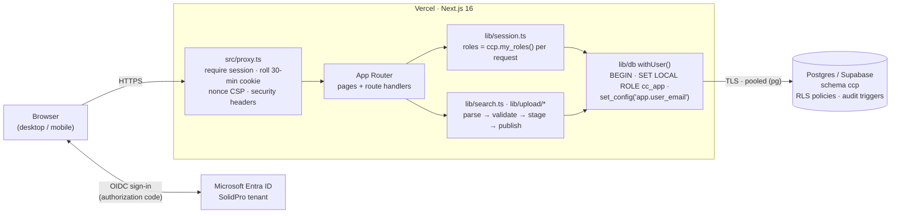

# SolidPro Cost Centre Portal

Internal web portal for **Solidpro Engineering Support Pvt Ltd**. It is the single source of truth
for cost centres. Employees use it to find the right cost centre code in seconds. Finance uses it
to maintain the cost centre master and its owners under audit. In later phases, cost centre owners
will see their budget against actuals.

Next.js 16 (App Router) · TypeScript · Tailwind CSS v4 · Auth.js v5 with Microsoft Entra ID ·
Postgres with row-level security (Supabase in production, embedded PGlite for local demos) ·
deployed on Vercel at `https://costcentre.solidpro-engineering.com`.

**Status: Phase 1.** Phase 1 delivers Microsoft sign-in, the Cost Centre Finder, and Admin
uploads of the cost centre master and owner mapping.

---

## Contents

1. [Business problem](#1-business-problem)
2. [Roles](#2-roles)
3. [Architecture](#3-architecture)
4. [Security model](#4-security-model)
5. [Quick start (local demo)](#5-quick-start-local-demo)
6. [Environment variables](#6-environment-variables)
7. [Microsoft Entra ID SSO](#7-microsoft-entra-id-sso)
8. [Supabase setup](#8-supabase-setup)
9. [Deploy to Vercel](#9-deploy-to-vercel)
10. [Granting roles](#10-granting-roles)
11. [Testing](#11-testing)
12. [Acceptance criteria](#12-acceptance-criteria)
13. [Roadmap](#13-roadmap)
14. [Known limitations and next steps](#14-known-limitations-and-next-steps)

Finance users should read the [Finance Admin Guide](docs/ADMIN_GUIDE.md), which covers the monthly SOP,
upload rules and every error code.

---

## 1. Business problem

Cost centre codes currently live in spreadsheets that Finance maintains. Employees who raise expense
claims, purchase requests and invoices guess the code or email Finance to ask. Mis-coded costs then
need reclassification journals at month-end. Owners are not recorded consistently, and no one can
easily see who changed a code and when.

The portal fixes this:

- **Finder.** Any employee can search by name, code, BU, department, owner or keyword, in any order and
  with partial words, and copy the code with one click. If nothing matches, the portal shows the
  Finance contact and logs the search so that Finance can add keywords.
- **Controlled master data.** Finance changes the master only through validated Excel/CSV uploads.
  An upload is all-or-nothing, is checked again when it is published, and every change is audited.
  Cost centres are never deleted; they are deactivated instead.
- **Ownership.** Every active cost centre has an owner and a backup owner. The owner mapping also
  controls who can see a cost centre's budget and actuals (Phase 2).

## 2. Roles

Roles are **read from the database on every request**. The session cookie only says who the user is.
Removing a grant or changing an owner therefore takes effect immediately.

| Role | How a user gets it | Phase 1 (live) | Phase 2 | Phase 3 |
|---|---|---|---|---|
| **Employee** | Any account on an allowed domain that can sign in | Finder: search active cost centres; see code, alias, BU, department, owner name and entity; copy the code; "Contact Finance" when nothing matches. **No financial data.** | — | — |
| **CC Owner / Backup** | Named as `Owner_Email` or `Backup_Owner_Email` in the owner mapping upload | Finder. "My Cost Centres" is shown as *coming in Phase 2* | **My Cost Centres**: budget against actuals and variances for their own cost centres only | Comment on variances; see allocations into their cost centre |
| **BU Head** | A `BU_Head` grant for a BU in `ccp.cc_access` (sees the whole BU), or named as `BU_Head_Email` in the owner mapping (sees those cost centres) | Finder | Every cost centre in their BU | Comments and allocations for their BU |
| **Finance Admin** | A `Finance` grant in `ccp.cc_access` | Finder and **Admin**: template download; upload, validate, publish and discard of the master and owner mapping; data-quality exceptions; recent uploads; audit log; failed-searches report. **The only role that can write master data.** | Budget/Actuals upload with trial-balance reconciliation | Allocations upload; audit reports and exports |
| **Management / CFO** | An `Mgmt` grant in `ccp.cc_access` | Finder (read access to all cost centres is already enforced in the database) | Company-wide, read-only view of every cost centre | Read-only reports |

Management cannot see the Admin area or the audit log. The audit log is visible to Finance only.

## 3. Architecture



| Path | What it is |
|---|---|
| `src/proxy.ts` | Runs before every request. Unauthenticated page requests are redirected to `/login` and API requests get `401`. Also sets the CSP nonce. |
| `src/lib/auth.config.ts`, `src/lib/auth.ts` | Auth.js configuration: Entra ID provider, tenant and domain checks, session lifetimes, login audit events |
| `src/lib/session.ts` | Current user and roles (from the database), `requireFinanceApi()` |
| `src/lib/db/core.ts` | `pg` / PGlite drivers, migrations, `withUser()` request scope |
| `src/lib/search.ts` | Finder query: multi-word, partial, any order, active cost centres only |
| `src/lib/upload/` | Templates (ExcelJS), parser, validation rules, stage/publish/discard service |
| `src/app/(portal)/` | Finder (`/`), Admin (`/admin`), Audit log and failed searches (`/admin/audit`) |
| `src/app/api/` | `search`, `admin/templates/[kind]`, `admin/upload`, `admin/upload/[id]`, `auth/[...nextauth]` |
| `db/migrations/` | `001_schema.sql` (tables), `002_security.sql` (role, RLS, triggers, audit) |
| `scripts/` | `db.ts` (migrate, seed, reset), `build-templates.ts` |

**Data model** (schema `ccp`):

- `cost_centres` is the master. It is never deleted.
- `cc_owners` holds one owner mapping per cost centre.
- `cc_access` holds explicit grants: Finance, Mgmt, BU_Head, and per-cost-centre grants.
- `financials`, `allocations` and `comments` are for Phases 2 and 3. They and their RLS policies already exist.
- `audit_log` is append-only.
- `failed_searches` holds searches that found nothing.
- `upload_batches` holds uploads being staged and the upload evidence.

## 4. Security model

Security is layered, so no single control has to be perfect:

```
 Entra ID SSO ──► tenant + domain check ──► proxy (session, headers) ──► server-side role check ──► Postgres RLS
 (who you are)    (are you SolidPro?)        (signed in? fresh?)          (Finance for admin)       (what rows you get)
```

| Layer | Control | Where |
|---|---|---|
| **Identity** | Microsoft Entra ID OIDC only. There are no local passwords and no self-registration. The issuer is pinned to the SolidPro tenant (`/{tenant-id}/v2.0`). | `auth.config.ts` |
| | The token's `tid` claim must equal `AUTH_MICROSOFT_ENTRA_ID_TENANT_ID`. This blocks the "nOAuth" attack, where a user from another tenant sets an `email` claim on our domain. | `signIn` callback |
| | The email (`email`, or `preferred_username` if there is no email) must be on `ALLOWED_EMAIL_DOMAINS`. It is checked at sign-in **and on every session refresh**. | `signIn` and `jwt` callbacks |
| | Recommended: turn on **Assignment required** on the Entra Enterprise App, so that only members of a chosen security group can sign in. | Entra admin centre |
| **Session** | Encrypted JWT cookie (Auth.js: HttpOnly, Secure, SameSite=Lax) with a **30-minute rolling idle timeout**. `maxAge` is 1800 s and the proxy re-issues the cookie on each request. There is also a **10-hour absolute limit** and a client-side idle timer that signs the user out after 30 minutes without input. | `config.ts`, `proxy.ts`, `IdleTimeout.tsx` |
| **Edge** | The proxy requires a session on every path except `/login` and `/api/auth/*`. It sets a nonce-based CSP with `strict-dynamic` and `frame-ancestors 'none'`. `next.config.ts` adds HSTS (2 years, preload), `X-Frame-Options: DENY`, `nosniff`, `Referrer-Policy` and `Permissions-Policy`, and removes `X-Powered-By`. Pages are marked `noindex`. | `proxy.ts`, `next.config.ts` |
| **Server** | Roles come from `ccp.my_roles()` on every request and are never cached in the cookie. Admin pages redirect non-Finance users. Admin APIs return `403` and log `ACCESS_DENIED`. Uploads are checked for type (`.xlsx`/`.csv`), size (5 MB) and row count (5,000). IDs are checked to be UUIDs. Search and template responses are `Cache-Control: private, no-store`. | `session.ts`, `app/api/**` |
| **Database** | Each request runs in a transaction as `cc_app`, a role with no `BYPASSRLS`, no `DELETE` on cost centres and no direct write access to the audit log, using `set_config('app.user_email', …)`. **RLS policies decide which rows each user gets** from `cc_access` and `cc_owners`, so a bug or a tampered request in the app cannot widen access. Schema `ccp` is not exposed through Supabase's REST API (the `anon` and `authenticated` roles are revoked). | `002_security.sql`, `db/core.ts` |
| **Integrity** | Triggers block deletion of cost centres. Deactivating a cost centre removes its owner mapping, and that removal is audited. Every insert, update and delete on `cost_centres`, `cc_owners` and `cc_access` is written to `audit_log` with who, when, old and new values (only the changed fields) and the upload batch id. `audit_log` rejects `UPDATE`, `DELETE` and `TRUNCATE`, even from the privileged migration connection. | `002_security.sql` |
| **Events** | `LOGIN`, `LOGIN_DENIED`, `LOGOUT` (sign-out or idle), `ACCESS_DENIED`, `TEMPLATE_DOWNLOAD`, `UPLOAD_VALIDATED`, `UPLOAD_REJECTED`, `UPLOAD_PUBLISHED` and `UPLOAD_DISCARDED` are logged through `ccp.log_event()`, which accepts only these actions and always records the caller's identity. | `auth.ts`, `logout/route.ts`, `upload/service.ts` |

**Excel library.** The portal uses **ExcelJS**, not SheetJS. The npm `xlsx` package (0.18.5) has
unpatched vulnerabilities: prototype pollution (CVE-2023-30533) and ReDoS (CVE-2024-22363). The
patched SheetJS builds are distributed only from `cdn.sheetjs.com`, not from the npm registry.
Uploaded files are parsed on the server only.

## 5. Quick start (local demo)

You need Node.js 20 or later. No database or Microsoft setup is required.

```bash
npm install
cp .env.example .env.local
#   edit .env.local:
#     AUTH_SECRET=<output of: npx auth secret   or   openssl rand -base64 32>
#     AUTH_DEMO_MODE=true
npm run dev
```

Open <http://localhost:3000>. When `DATABASE_URL` is not set, the first request creates an embedded
Postgres (PGlite) database in `./.pglite`, runs the migrations and loads demo data. The demo data has
10 active cost centres, 1 inactive cost centre (`IN-ENG-199`) and six months of financials
(2026-04 to 2026-09). The login page then offers **demo users**:

| Demo user | Role | What to try |
|---|---|---|
| `arun.kumar@solidpro-es.com` | Employee | Search `chen des`, `laptop` or `ineng101`; search something that does not exist |
| `meena.raj@solidpro-es.com` | CC Owner (`IN-ENG-101`, `IN-ENG-102`) | Same Finder view; *My Cost Centres* is a Phase 2 placeholder |
| `vikram.iyer@solidpro-es.com` | BU Head, Engineering | Finder |
| `kavya.s@solidpro-es.com` | Finance Admin | **Admin**: download a template, upload it, read the errors, publish; view the audit log |
| `rajesh.n@solidpro-es.com` | Management / CFO | Finder; no Admin |

To start again with fresh demo data, stop the dev server, then delete `./.pglite` (or run `npm run db:reset`).
To build the Excel templates into `./templates/`, run `npm run templates`.

To try **real Microsoft sign-in** locally, set the three `AUTH_MICROSOFT_ENTRA_ID_*` variables
([§7](#7-microsoft-entra-id-sso)) and register `http://localhost:3000/api/auth/callback/microsoft-entra-id`.

## 6. Environment variables

Every variable is described in [`.env.example`](.env.example).

| Variable | Required | Default | Purpose |
|---|---|---|---|
| `AUTH_SECRET` | **Yes** | — | Encrypts the session cookie. Generate it with `npx auth secret` or `openssl rand -base64 32`. Use a different value for each environment. |
| `AUTH_URL` | Production | auto-detected | Public URL, e.g. `https://costcentre.solidpro-engineering.com`. On Vercel, set it for **Production only**. |
| `AUTH_MICROSOFT_ENTRA_ID_ID` | For SSO | — | Application (client) ID |
| `AUTH_MICROSOFT_ENTRA_ID_SECRET` | For SSO | — | Client secret **value** |
| `AUTH_MICROSOFT_ENTRA_ID_TENANT_ID` | For SSO (**always set**) | — | Directory (tenant) ID. Pins the issuer and turns on the `tid` check. If it is not set, Auth.js falls back to the multi-tenant `common` endpoint. |
| `AUTH_MICROSOFT_ENTRA_ID_ISSUER` | No | — | Issuer override, used only when the tenant ID is not set. Not recommended. |
| `ALLOWED_EMAIL_DOMAINS` | No | `solidpro-es.com` | Comma-separated list of domains allowed to sign in. Owner, backup and BU-head emails in uploads must also use these domains. |
| `FINANCE_CONTACT_EMAIL` | No | `finance@solidpro-es.com` | Shown when a search finds nothing |
| `AUTH_DEMO_MODE` | No | `false` | `true` shows the demo-user picker with no password. It is always off when `VERCEL_ENV=production`. **Never enable it on any deployment connected to real data, previews included.** |
| `DATABASE_URL` | Production | — (PGlite) | Postgres connection string. For Supabase, use the pooler string. **Do not add `?sslmode=`**, because it overrides the two SSL variables below. |
| `DATABASE_POOL_MAX` | No | `5` | Connection pool size for each server instance |
| `DATABASE_SSL` | No | on | Set to `false` to turn off TLS for a local Postgres. `sslmode=disable` in the URL does the same. |
| `DATABASE_SSL_STRICT` | No | `true` | Set to `false` to skip verification of the server certificate. The connection is still encrypted. See [§8](#8-supabase-setup). |
| `PGLITE_DATA_DIR` | No | `./.pglite` | Folder for the embedded database when `DATABASE_URL` is not set. `memory` keeps it in memory only. |
| `ALLOW_EMBEDDED_DB` | No | — | `true` allows PGlite when `NODE_ENV=production`, e.g. for an `npm run build && npm start` demo. Never use it for a real deployment. |
| `CONFIRM_RESET` | Scripts | — | `yes` is required before `npm run db:reset` will drop a **remote** database |

> The `npm run db:*` scripts **do not read `.env.local`**. Export the variables in your shell, or run
> `npx tsx --env-file=.env.local scripts/db.ts migrate`. If you do neither, the scripts quietly work
> on the local PGlite database instead.

## 7. Microsoft Entra ID SSO

Do these steps in the **Microsoft Entra admin centre** (entra.microsoft.com). You need the
Application Administrator role or higher.

1. **Register the app.** Go to *App registrations → New registration* (under *Entra ID*, or *Identity → Applications* in older menus).
   - Name: `SolidPro Cost Centre Portal`
   - Supported account types: **Accounts in this organizational directory only (single tenant)**
   - Redirect URI: platform **Web**, `https://costcentre.solidpro-engineering.com/api/auth/callback/microsoft-entra-id`
2. **Add the development redirect.** Go to *Authentication → Web → Add URI*:
   `http://localhost:3000/api/auth/callback/microsoft-entra-id`. Add a URI for a staging host here too
   if you use one. Leave both *Implicit grant* boxes **unticked**, because the portal uses the
   authorization-code flow.
3. **Copy the IDs.** On *Overview*:
   - **Application (client) ID** → `AUTH_MICROSOFT_ENTRA_ID_ID`
   - **Directory (tenant) ID** → `AUTH_MICROSOFT_ENTRA_ID_TENANT_ID`
4. **Create a secret.** Go to *Certificates & secrets → Client secrets → New client secret*, for example
   with a 12-month expiry. Copy the **Value**, not the *Secret ID*, into `AUTH_MICROSOFT_ENTRA_ID_SECRET`.
   Set a calendar reminder to rotate it before it expires. Sign-in stops working when it expires.
5. **Set API permissions.** The portal requests only `openid profile email`. Under *API permissions*,
   make sure Microsoft Graph delegated `openid`, `profile` and `email` are listed, then click
   **Grant admin consent for SolidPro**. The default `User.Read` permission can stay; the app does not use it.
6. **Optionally add the email claim.** Under *Token configuration → Add optional claim → ID → `email`*. The portal
   uses the `email` claim and falls back to `preferred_username` (the UPN). Either one must be on
   `ALLOWED_EMAIL_DOMAINS`.
7. **Restrict sign-in (recommended).** Go to *Enterprise applications → SolidPro Cost Centre Portal → Properties*,
   set **Assignment required? = Yes**, then under *Users and groups* add the security group allowed
   to use the portal, e.g. all employees. Users outside the group are stopped by Microsoft before they
   reach the portal. Conditional Access policies such as MFA and compliant devices apply as usual.
8. **Set the environment variables** on Vercel ([§9](#9-deploy-to-vercel)) and redeploy. Sign in as a test
   user. A `LOGIN` row should appear in the audit log.

How it fits together: the sign-in callback is `/api/auth/callback/microsoft-entra-id`. The portal checks
the `tid` claim against the tenant ID and the email domain against `ALLOWED_EMAIL_DOMAINS`. A failed
check shows *Access denied* on the login page and logs `LOGIN_DENIED`. Signing out of the portal does
not sign the user out of Microsoft 365.

## 8. Supabase setup

1. **Create a project.** Pick the region closest to users, e.g. *South Asia (Mumbai)*. Save the database password.
2. **Get the connection string.** Go to *Project → Connect → Connection string*.
   - For the **app** (Vercel), use the **Transaction pooler** string on port **6543**. Transaction pooling is
     safe here, because the role and user settings are set with `SET LOCAL` and `set_config(..., true)` and
     last only for the current transaction.
   - For **migrations**, use the same string, or the Session pooler or direct connection.
3. **Run the migrations from your machine.** The scripts do not read `.env.local`:
   ```bash
   export DATABASE_URL='postgresql://postgres.<ref>:<password>@aws-0-<region>.pooler.supabase.com:6543/postgres'
   npm run db:migrate          # creates schema ccp, role cc_app, RLS, triggers
   ```
   The migrations are recorded in `ccp.schema_migrations` and are safe to re-run.
4. **Demo data (optional).** Run `npm run db:seed` **only on a demo or staging project**. The seed gives
   Finance, Mgmt and BU-head rights to the demo addresses on the real `solidpro-es.com` domain, for example
   `kavya.s@` and `rajesh.n@`. **Never seed production.**
5. **Bootstrap the first Finance admin.** See [§10](#10-granting-roles).
6. **Check the setup.**
   - *Project Settings → Data API → Exposed schemas* should list only `public` (and `graphql_public`). **Do not add `ccp`.**
   - In the SQL editor, run
     `select relname, relrowsecurity from pg_class where relnamespace = 'ccp'::regnamespace and relkind = 'r';`.
     Every table except `schema_migrations` should show `true`.
7. **TLS.** Certificate verification is on by default. If the connection fails with
   `self-signed certificate in certificate chain`, Node does not trust Supabase's CA. You have two options:
   - Download the CA from *Project Settings → Database → SSL Configuration* and point `NODE_EXTRA_CA_CERTS` at it.
     This is the stronger option and works well for running scripts locally.
   - Set `DATABASE_SSL_STRICT=false`. The connection stays encrypted, but the server's identity is not verified.

## 9. Deploy to Vercel

1. **Import the project.** Push the repository to GitHub. In Vercel, go to *Add New → Project*, import the repo
   and accept the defaults: framework Next.js, `next build`, Node 20+.
2. **Set the function region.** Under *Settings → Functions → Function Region*, pick the region closest to the
   Supabase database, e.g. `bom1` (Mumbai), to keep queries fast.
3. **Add the environment variables.** Go to *Settings → Environment Variables*. Set these for **Production**:
   | Variable | Value |
   |---|---|
   | `DATABASE_URL` | Supabase transaction-pooler string ([§8](#8-supabase-setup)) |
   | `AUTH_SECRET` | New random value, different from the one used locally |
   | `AUTH_URL` | `https://costcentre.solidpro-engineering.com` (Production only) |
   | `AUTH_MICROSOFT_ENTRA_ID_ID` / `_SECRET` / `_TENANT_ID` | From [§7](#7-microsoft-entra-id-sso) |
   | `ALLOWED_EMAIL_DOMAINS` | `solidpro-es.com` |
   | `FINANCE_CONTACT_EMAIL` | Finance shared mailbox |

   - Do **not** set `AUTH_DEMO_MODE` in Production. It is ignored there anyway.
   - For Preview deployments, use a **separate staging database**, or protect them with Vercel
     Deployment Protection.
   - Variables that are sensitive (secret, database URL) should be marked *Sensitive*.
4. **Deploy.** Run *Deployments → Redeploy*, or push to the production branch.
5. **Set up the custom subdomain.**
   1. In Vercel, go to *Settings → Domains → Add* and enter `costcentre.solidpro-engineering.com`.
   2. At the DNS provider for `solidpro-engineering.com`, create a **CNAME** record:
      `costcentre` → `cname.vercel-dns.com`. If Vercel shows a project-specific target, use that instead.
   3. Wait for Vercel to verify the domain and issue the TLS certificate. This is automatic and usually
      takes a few minutes.
   4. Check that the Entra redirect URI uses this host and that `AUTH_URL` matches it.
6. **Smoke test.**
   - Sign in with a company account.
   - A personal Microsoft account is refused.
   - Search returns results.
   - A non-Finance user gets `403` from `/api/admin/templates/master`.
   - The response headers include `Strict-Transport-Security` and `Content-Security-Policy`.
   - `LOGIN` appears in the audit log.

## 10. Granting roles

- **Owner, backup and BU head** for each cost centre come from the **owner mapping upload**. Finance
  maintains them in the portal. No SQL is needed.
- **Finance, Management and BU-wide BU Head** are explicit grants in `ccp.cc_access`. Phase 1 has no
  screen for these, so IT runs the SQL as a controlled change, for example in the Supabase SQL editor.
  Setting `app.user_email` records the person running the SQL as the actor in the audit log. Without it,
  the actor is `system`.

```sql
begin;
select set_config('app.user_email', 'it.admin@solidpro-es.com', true);   -- who is making the change

-- Finance Admin (full access + Admin area)
insert into ccp.cc_access (user_email, role, created_by) values ('name@solidpro-es.com', 'Finance', 'CHG-1234');
-- Management / CFO (read-only, all cost centres)
insert into ccp.cc_access (user_email, role, created_by) values ('cfo@solidpro-es.com', 'Mgmt', 'CHG-1234');
-- BU Head for a whole BU (bu must match cost_centres.bu exactly, e.g. 'Engineering')
insert into ccp.cc_access (user_email, role, bu, created_by) values ('head@solidpro-es.com', 'BU_Head', 'Engineering', 'CHG-1234');

-- Revoke
delete from ccp.cc_access where user_email = 'name@solidpro-es.com' and role = 'Finance';
commit;

-- Review: who holds which grant
select user_email, role, bu, cc_code, created_at, created_by from ccp.cc_access order by role, user_email;
```

Emails must be **lower case** (the database enforces this) and must be the address the user signs in
with. Changes take effect on the user's next page load.

## 11. Testing

```bash
npm test          # vitest: unit and database tests against an in-memory PGlite; no network or Supabase needed
npm run lint      # TypeScript type check (tsc --noEmit)
npm run build     # production build
```

Tests live in `tests/*.test.ts`. They use a fresh in-memory database with the real migrations and the demo seed.
`tests/helpers.ts` provides `freshDb()`, `as(user, sql)` (run as `cc_app` with RLS) and `asSuper()`.

| File | Covers |
|---|---|
| `tests/rls.test.ts` | Row-level security for every role, including tampered or direct SQL; write restrictions; no-delete; deactivation cascade; audit trail contents; append-only audit log; failed-search logging |
| `tests/search.test.ts` | Term parsing; multi-word, partial and any-order search; code with or without dashes; owner, keyword, BU and department search; inactive cost centres excluded; LIKE and injection safety; **< 1 s with 510 cost centres** |

## 12. Acceptance criteria

Phase 1 acceptance criteria, how each one is met, and the evidence for it. *Manual* means the
criterion is checked in the UAT smoke test ([§9](#9-deploy-to-vercel), step 6).

| # | Acceptance criterion | How it is met | Proven by |
|---|---|---|---|
| 1 | Only SolidPro Microsoft 365 accounts can sign in. There is no self-registration and there are no local passwords. | Entra ID single-tenant OIDC, `tid` check and domain allow-list in the `signIn` and `jwt` callbacks; `LOGIN_DENIED` is logged | Manual (personal and external accounts are refused) |
| 2 | The session ends after 30 minutes of inactivity. | Rolling 30-minute JWT re-issued by the proxy, client idle timer, 10-hour absolute limit | Manual |
| 3 | Every page and API needs sign-in. | `proxy.ts` (redirect or `401`) plus a check in each route | Manual |
| 4 | An employee finds a cost centre by partial, multi-word, any-order search across code, alias, BU, department, owner and keywords (e.g. `chen des` finds *Design Chennai*). | `lib/search.ts` | `search.test.ts`: `"chen des" finds IN-ENG-101`, *matches partial words*, *matches words in any order*, *finds by owner name / keyword / BU and department* |
| 5 | Search results appear in under 1 second. | One SQL query over active cost centres, with a 300 ms client debounce | `search.test.ts`: *each search … completes in < 1000 ms with 510 active CCs* |
| 6 | Inactive cost centres never appear in the Finder. | `status = 'Active'` filter | `search.test.ts`: *never returns the inactive IN-ENG-199* |
| 7 | The code can be copied with one click. | *Copy code* button with a clipboard fallback | Manual |
| 8 | When nothing matches, the user sees "Contact Finance", and the search is logged for keyword maintenance. | Finder message; `ccp.log_failed_search()`; report at `/admin/audit` | `rls.test.ts`: *log_failed_search collapses keystrokes …* |
| 9 | Employees see no financial data, even when calling the API directly or changing IDs. | RLS on `financials`, `allocations`, `comments`, `audit_log`, `upload_batches`, `failed_searches` | `rls.test.ts`: *Employee sees 0 rows in every protected table …* |
| 10 | Owners see only their own cost centres, BU heads see their BU, and Finance and Management see everything. | `ccp.visible_cc_codes()` in the RLS policies | `rls.test.ts`: *Owner sees financials only …*, *backup owner …*, *BU head sees all Engineering …*, *Mgmt sees all …*, *Finance sees all …* |
| 11 | Only Finance can change master data or use Admin. | RLS write policies; admin page redirect; admin APIs return `403` and log `ACCESS_DENIED` | `rls.test.ts`: *Mgmt cannot insert or update …*, *Non-finance users cannot …* |
| 12 | Finance can download templates and upload the master and owner mapping as `.xlsx` or `.csv`. | `/api/admin/templates/[kind]`, `/api/admin/upload` | Manual. Templates in `templates/` are generated by `npm run templates`. |
| 13 | An invalid file is rejected as a whole, with a row-by-row error report covering duplicate codes and aliases, missing owner or backup, external emails, an inactive cost centre with an owner, and bad dates. Nothing is partly loaded. | `lib/upload/validate.ts`; the batch is marked `Rejected` | Covered by the validation rules in `validate.ts`. **Unit tests are pending.** |
| 14 | A clean file shows a preview (new, updated, unchanged and warnings) and is then published or discarded. Publishing validates the file again against the current data. | `lib/upload/service.ts` | **Tests pending.** Manual. |
| 15 | Cost centres cannot be deleted. Deactivation needs a close date and removes the owner mapping. | `cost_centres_no_delete` trigger, CHECK constraints, `tg_cc_deactivated` | `rls.test.ts`: *Nobody can delete a cost centre …*, *Deactivating a cost centre removes its owner mapping …* |
| 16 | Every change is audited with who, what, when and the old and new values, and the audit log cannot be changed. | Audit triggers, `log_event()`, append-only triggers | `rls.test.ts`: *Finance can update a cost centre; audit_log records who …*, *audit_log is append-only …* |
| 17 | The portal works on mobile and follows the SolidPro brand (Blue `#16469D`, Red `#E01A22`, Grey `#939597`, Maven Pro). | Responsive Tailwind layout and brand tokens in `globals.css` | Manual |
| 18 | Security headers are sent. | CSP (nonce), HSTS, `X-Frame-Options`, `nosniff`, `Referrer-Policy`, `Permissions-Policy` | Manual (`curl -I`) |

## 13. Roadmap

| Phase | Scope |
|---|---|
| **1 — live** | Microsoft Entra ID SSO; Cost Centre Finder; Admin upload of the master and owner mapping with validation, preview, publish and discard; audit log; failed-searches report; RLS for every future data set |
| **2** | **My Cost Centres** for owners, backups, BU heads and Management: budget against actuals by GL group and month, with >10% variances flagged. **Budget/Actuals upload** using the financials template, with **trial-balance reconciliation**: the upload must tie to the Tally trial balance before it can be published. Maker-checker for publishing. |
| **3** | Owner comments on variances; shared-service **allocations** view and upload; **audit reports** with filters and Excel export (`EXPORT` is already whitelisted in `log_event`) |

## 14. Known limitations and next steps

- **No maker-checker in Phase 1.** The same Finance user can upload and publish. The compensating
  control is the second-person review in the [Admin Guide SOP](docs/ADMIN_GUIDE.md#1-monthly-sop-checklist).
  Next step: require `published_by <> uploaded_by` in `publishUpload` and in an RLS check.
- **No screen for role management.** Finance, Management and BU-head grants are SQL changes
  ([§10](#10-granting-roles)).
- **No export of the current master.** Finance keeps its own working copy, because an upload row must
  be a complete record.
- **Uploads only add or update rows.** Rows that are not in a file are untouched. The only way to remove
  an owner mapping is to deactivate the cost centre. To swap aliases between two cost centres, use two uploads.
- **A validated batch cannot be resumed from the UI** after leaving the page, and it stays *Validated*
  in the history. Next step: let Finance publish or discard from *Recent uploads*, and expire old batches.
- **The audit screen is basic.** It shows the latest 200 events with no filters, and it does not show the
  batch id or file SHA-256. Use the SQL in the Admin Guide until Phase 3 audit reports arrive.
- **Sessions are not revoked centrally.** Disabling an Entra account blocks new sign-ins, but an open
  portal session lasts until the 30-minute idle or 10-hour absolute limit. Signing out of the portal
  does not sign the user out of Microsoft.
- **The tenant ID is not enforced at startup.** If `AUTH_MICROSOFT_ENTRA_ID_TENANT_ID` is missing,
  Auth.js uses the `common` endpoint and skips the `tid` check, leaving only the domain check. Always set it.
- **Database TLS.** There is no variable for a custom CA, and an `sslmode` in `DATABASE_URL` overrides
  `DATABASE_SSL_STRICT` ([§8](#8-supabase-setup)).
- **The `npm run db:*` scripts do not load `.env.local`** ([§6](#6-environment-variables)).
- **Failed searches are kept indefinitely,** together with the user's email. Define a retention period.
- **The app connects with the database owner's credentials** (the same ones used for migrations) and
  switches to `cc_app` in each transaction. All SQL is parameterised. Still, a dedicated login role that
  is only a member of `cc_app` would limit the damage of any future SQL-injection bug, and the owner
  credentials, which could disable the audit triggers, would stay with IT for migrations only.
  For example: `create role cc_app_login login password '…' noinherit; grant cc_app to cc_app_login;`,
  then use that role in `DATABASE_URL`.
- **`/api/search` has no rate limit** beyond requiring sign-in. If needed, add a Vercel WAF rate-limit rule.
- The **financials template** can be downloaded already, but uploading financials arrives in Phase 2.
